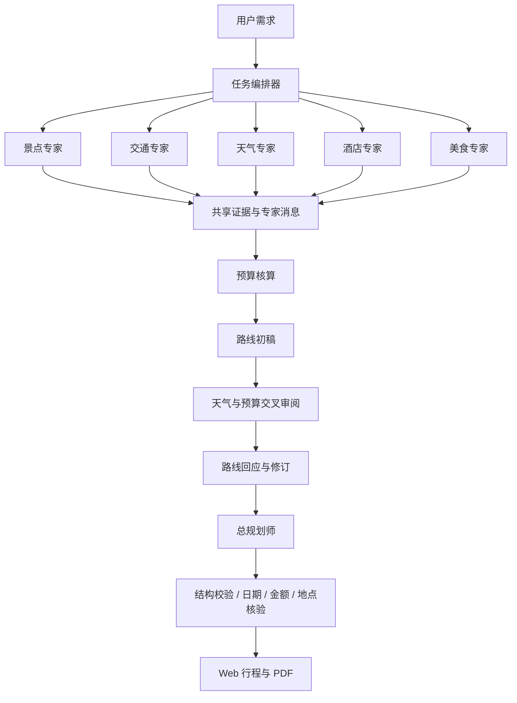

# 山行 Roam · 多智能体旅行规划

可在本机运行的前后端分离 Web 应用。React 界面、Node.js API、OpenAI 兼容模型接口，包含 7 位专家和 1 位总规划师。

## 立即运行

需要 Node.js 20.15+，推荐 Node.js 22 LTS。Windows PDF 导出自动使用已安装的 Edge 或 Chrome。

```powershell
npm ci
npm run dev
```

打开 <http://127.0.0.1:5173/>，后端位于 <http://127.0.0.1:8787/>。也可以在 PowerShell 中运行项目内的 `启动山行.ps1`。按 Ctrl+C 停止服务。

首次使用可复制 `.env.example` 为 `.env`，填写模型的 Base URL、模型名和 API Key；也可以启动后在「模型与工具」中配置。支持 DeepSeek 及其他 OpenAI 兼容接口。配置仅在后端使用，`.env` 不会提交到 Git。若模型返回 HTTP 402，请检查模型服务账户余额。

**无需外部凭据即可点击「体验南京示例」**，体验协作动态、每日行程、路线示意、预算、历史记录与 PDF 下载。示例是固定的上海出发、2 人、南京 3 天方案，不消耗模型额度、不伪造实时数据。

## 已实现

- 出发地、目的地、日期、1–14 天行程、人数、全体总预算、交通方式、兴趣、旅行节奏和补充需求。
- 5 位信息专家并行研究，预算和路线整合，再由天气与预算专家交叉审阅，路线专家回应、修订，最后总规划师输出经过结构校验的方案。
- 独立模型对话上下文、函数工具调用、带收件人的专家消息、共享证据、SSE 实时事件、取消任务、失败原因展示和一次结构修复。
- 7 位专家对应景点、往返交通、天气、酒店、地方美食、预算、路线。模型工具调用受专家权限与调用轮数限制。
- 可配置的高德 MCP / REST、铁路和机票 MCP、Open-Meteo、Tavily、小红书/携程域名搜索、Unsplash 景区与美食图片搜索。
- 旅行历史持久化、刷新恢复、逐日路线切换、来源详情、参考费用加总和超预算提示。
- PDF 封面、概览、每日行程、每一天的地图编号、预算、交通、住宿、提醒和来源记录。
- 桌面和手机响应式界面；设置弹窗支持键盘操作。

## 外部服务配置

可以直接在页面侧栏「模型与工具」填写，保存后用于下一次规划。密钥字段留空表示保留原值；配置接口只返回是否已配置，不回传密钥。配置覆盖保存在 `.data/config.json`；如需清除，可以使用配置 API 的 `clearKeys` 或手动移除本地配置中的对应字段。

| 服务 | 配置 | 未配置时的行为 |
| --- | --- | --- |
| 大模型 | `LLM_BASE_URL`、`LLM_MODEL`、`LLM_API_KEY` | 真实规划提示补充配置；离线演示正常工作 |
| 高德地图 | `AMAP_KEY`，**Web 服务类型** Key | 不核验 POI/坐标；不伪装为高德底图 |
| Unsplash | `UNSPLASH_ACCESS_KEY` | 不发起动态图片搜索；首页使用署名来源的静态意象照片 |
| Tavily 搜索 | `TAVILY_API_KEY` | 搜索显示未配置；也可接入搜索 MCP |
| 天气 | 无需 Key，Open-Meteo | 网络失败或日期超出预报窗口时保留未知 |
| 铁路 MCP | 设置中的 MCP 服务地址，角色勾选交通 | 不生成虚构班次、时刻、余票或价格 |
| 机票 MCP | 单独的航班查询服务，角色勾选交通 | 同上；12306 不是机票服务 |

高德 Key 保存后会自动尝试官方 `https://mcp.amap.com/mcp?key=...`，同时保留后端 REST 适配器。Key 不会放到前端地图 URL，静态地图由后端获取并以内嵌图片返回。用于 PDF 的静态地图服务需要具备相应权限与额度。

手动从三行配置文件导入模型（依次为 Key、Base URL、模型名）

```powershell
npm run import-config -- "C:\path\to\model-config.txt"
```

### MCP 服务

支持 Streamable HTTP 和 SSE，可配置 Bearer Token、服务名称和分配专家。设置中的「测试」会实际连接并列出允许的查询工具数。铁路社区项目示例

```powershell
npx -y 12306-mcp --port 8000
```

将该服务实际打印的 MCP 端点填入设置。HTTP 端点通常为 `/mcp`，旧服务也可能是 `/sse`；按所用服务文档选择。该命令不会由本项目自动执行。

也可在 `.env` 中配置

```dotenv
MCP_SERVERS=[{"id":"rail","name":"12306","url":"http://127.0.0.1:8000/mcp","transport":"http","roles":["transport"]}]
```

角色可用 `attractions`、`transport`、`weather`、`hotel`、`food`、`budget`、`route`。高级配置可提供 `allowedTools` 限定具体工具名。购买、付款、删除、提交、执行命令等工具始终被排除；本应用只规划，不进行预订。

## 数据口径

总预算是**全体旅客整个行程**的预算。住宿按房间和晚数，交通按往返和人数；模型输出的分项由后端重新求和。未知金额使用 `null` 并单独计数，不能把合计当作完整价格。模型给出的费用统一标为参考估算。

地点坐标仅来自高德 POI 核验，采用 GCJ-02。模型自报坐标不会用于地图。图上折线表示游览顺序，**不是道路导航路线**。高德静态图总览受 10 个标注、4 条折线限制，界面会说明截断；每一天单独导出的地图包含当天地点。

没有高德 Key 时，演示方案显示「非高德底图」的游览顺序示意；真实方案如无核验坐标，则展示待接入说明。配置 Key 后重新生成行程即可获得坐标与高德地图；已生成的演示方案也可以在导出时取得底图。

天气只使用工具返回且覆盖指定日期的预报。超出预报窗口的日子不按历史均值冒充预报。Open-Meteo 免费接口适用于非商业用途，商业部署需评估其服务方案。

Web Search 只涵盖搜索引擎可索引内容，不保证小红书、携程的全部内容可访问。搜索摘要、POI 和模型推荐都不等于实时库存或确认价格。

Unsplash 是**真实照片搜索**，并非 AI 图片生成。结果使用 API 原图地址并显示摄影师与 Unsplash 链接。当前 PDF 保留地图与行程，不下载或内嵌图库照片。

## 架构与目录

```text
client/                 React + Vite + TypeScript
  src/App.tsx           规划表单、行程、预算、协作与历史
  src/Settings.tsx      模型和工具设置
  src/MapView.tsx       地图与每天的景点编号
server/src/
  index.ts              HTTP API、SSE、来源校验、访问口令
  workflow.ts           多智能体编排、交流、审阅与汇总
  llm.ts                OpenAI 兼容模型驱动
  mcp.ts                MCP 动态发现与查询权限
  tools.ts              地图、天气、搜索、票务状态、预算、图片
  maps.ts               高德静态地图与明确标注的示意图
  pdf.ts                中文 HTML → Chromium PDF
  schema.ts             输入和输出校验、日期、金额计算
  store.ts              本地持久化、任务事件与取消
shared/types.ts         前后端共享数据类型
server/tests/           规则、MCP 协议与全流程测试
scripts/ui-smoke.mjs    桌面/手机 UI 与真实 PDF 下载检查
.data/                  本机配置与旅行记录，不提交 Git
output/                 检查截图与演示 PDF，不提交 Git
```



模型调用在后端执行。初始专家各有独立上下文；下游专家收到上游报告和证据，交叉审阅产生明确的收件人消息，路线专家再回应。界面呈现业务结论和工具状态，不展示模型内部推理。

当前是单用户、单进程本地应用；并行任务最多 3 个，专家工具调用最多 4 轮，每轮执行最多 4 个工具。长请求可取消。服务重启会将未完成任务标为中断，可重新规划。任务与设置以本地 JSON 保存；多人部署需要增加账户隔离、数据库和持久任务队列。

## 验证

```powershell
npm run check
npm test
npm run build
npm run test:production
# 另一个终端保持 npm run dev 运行
npm run test:ui
```

单元/集成测试使用隔离的本地模型服务和本地 MCP 服务，不消耗真实模型额度。覆盖跨月日期、未知预算、工具权限、真实 MCP HTTP 协商、函数调用、7 位专家、交叉审阅、坐标防伪、缺失天气、402 错误和任务取消。UI 检查涵盖桌面/390px 手机界面、示例流程、路线切换、预算、配置、历史恢复、PDF 下载和无横向溢出。

已验证本地演示、模型与 MCP 模拟服务、生产构建和 PDF 导出。真实模型规划及高德、铁路/机票、Tavily、Unsplash 查询仍需配置有效凭据并进行实网验证。

## 生产构建与部署

```powershell
npm run build
npm start
```

生产模式由后端提供 `client/dist` 静态资源，访问 <http://127.0.0.1:8787/>。前端仍是独立构建产物，可放到独立静态站点，通过 `VITE_API_BASE` 指定 API 地址；跨域时在后端设置 `ALLOWED_ORIGINS`。

PDF 自动探测 Windows Edge/Chrome、macOS Chrome、Linux Chromium。找不到时设置 `BROWSER_EXECUTABLE_PATH`。界面字体优先本机字体，中文标题可加载 Google Fonts；网络不可用时自动回退。

提供 `Dockerfile` 与 `compose.yaml`，镜像包含 Chromium 和中文字体。部署前在 `.env` 设置强随机 `APP_ACCESS_TOKEN`，随后

```powershell
docker compose up --build -d
```

容器内监听 `0.0.0.0`，宿主机默认只映射到 `127.0.0.1:8787`。公网使用 HTTPS 反向代理，并将域名加入 `ALLOWED_ORIGINS`。首次进入页面需要访问口令。所有使用者共享同一个服务空间，该配置不是多人账户系统。

`.env`、`.data` 和模型 Key 均已排除 Git 与 Docker 构建上下文。不要把这两个目录放到静态文件服务中。当前只在本机运行，未发布线上站点。

## 实现参考

- [DeepSeek Chat Completions](https://api-docs.deepseek.com/api/create-chat-completion/)
- [高德 MCP 快速接入](https://developer.amap.com/api/mcp-server/gettingstarted)
- [高德静态地图](https://developer.amap.com/api/webservice/guide/api/staticmaps/)
- [12306 MCP 社区实现](https://github.com/Joooook/12306-mcp)
- [MCP TypeScript SDK](https://github.com/modelcontextprotocol/typescript-sdk)
- [Open-Meteo 预报文档](https://open-meteo.com/en/docs)
- [Tavily Search](https://docs.tavily.com/documentation/api-reference/endpoint/search)
- [Unsplash API 文档](https://unsplash.com/documentation)

首页山水照片来自 [Unsplash 漓江图片](https://unsplash.com/s/photos/li-river)，仅用于旅行意象展示；南京示例的照片搜索不会伪装成已完成。
