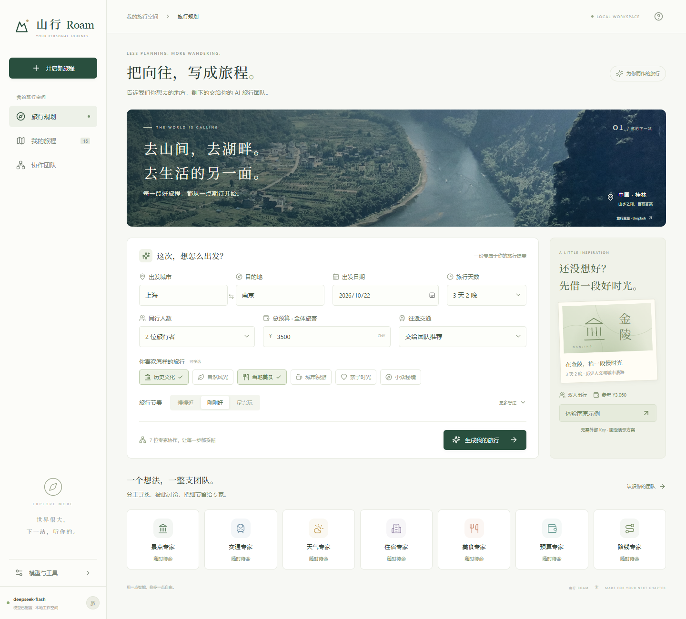
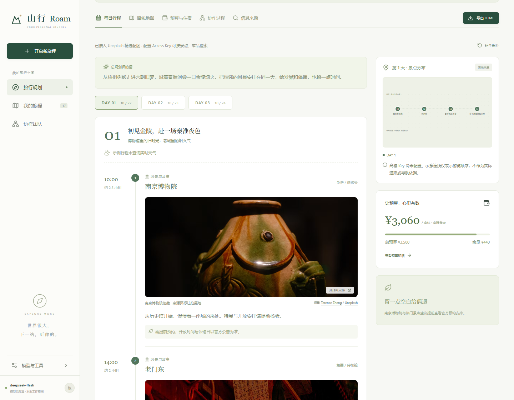
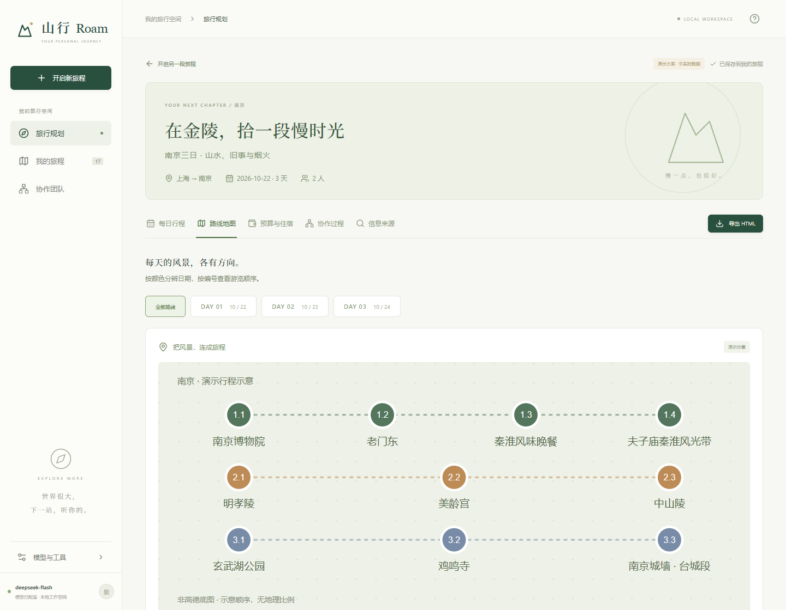
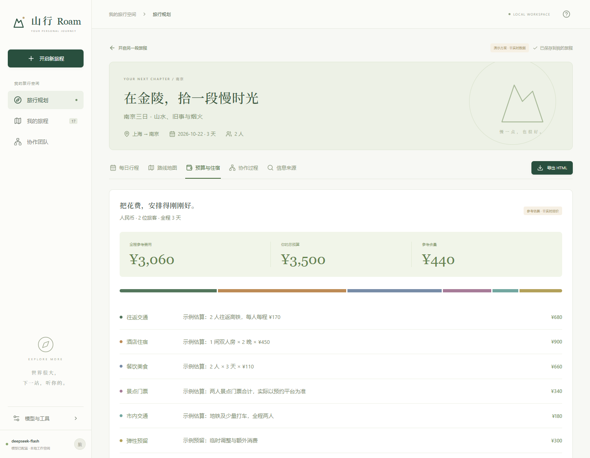
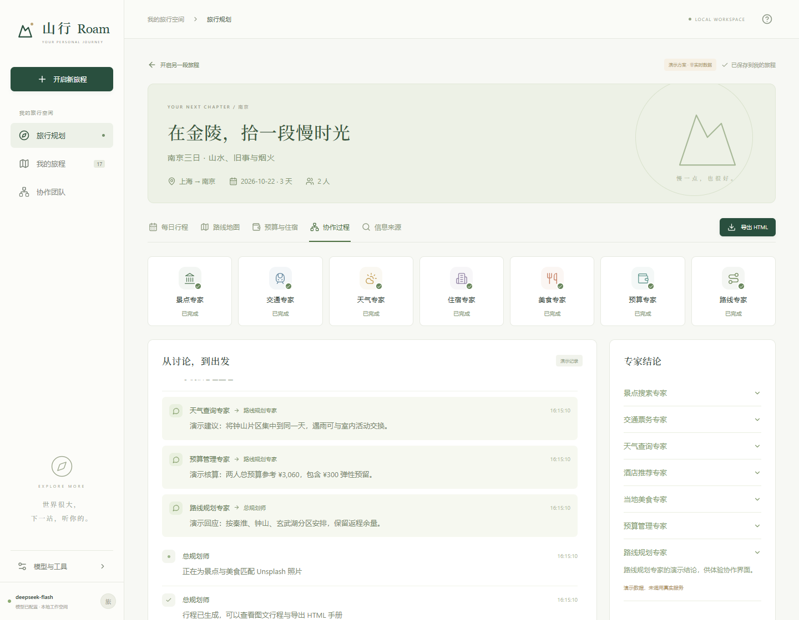
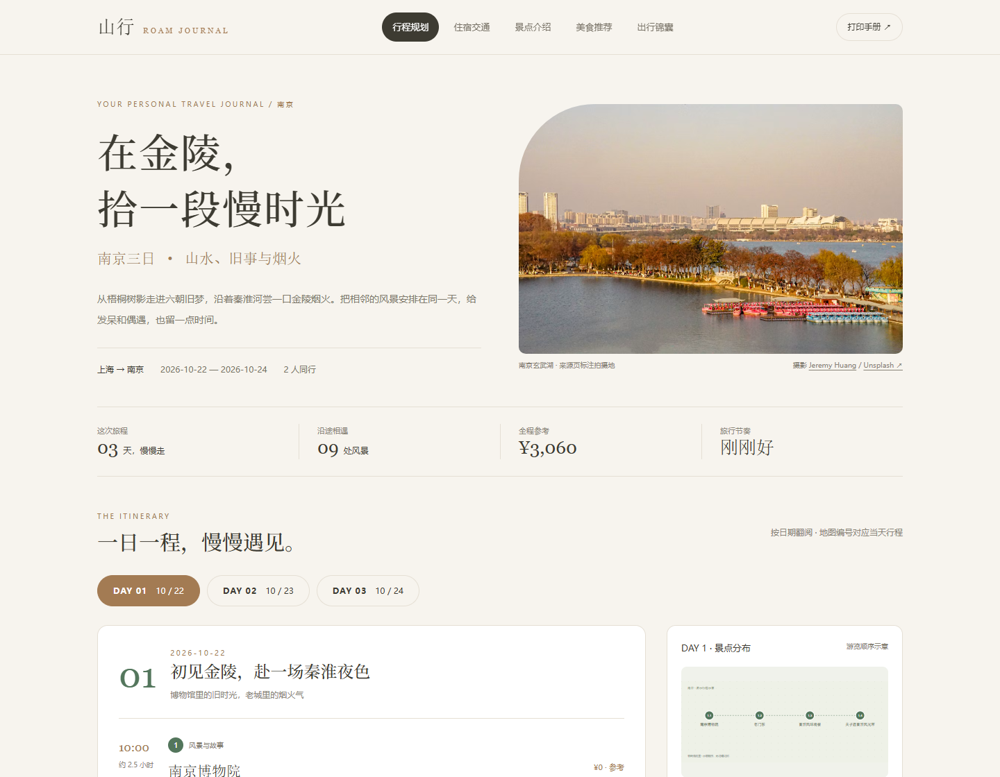
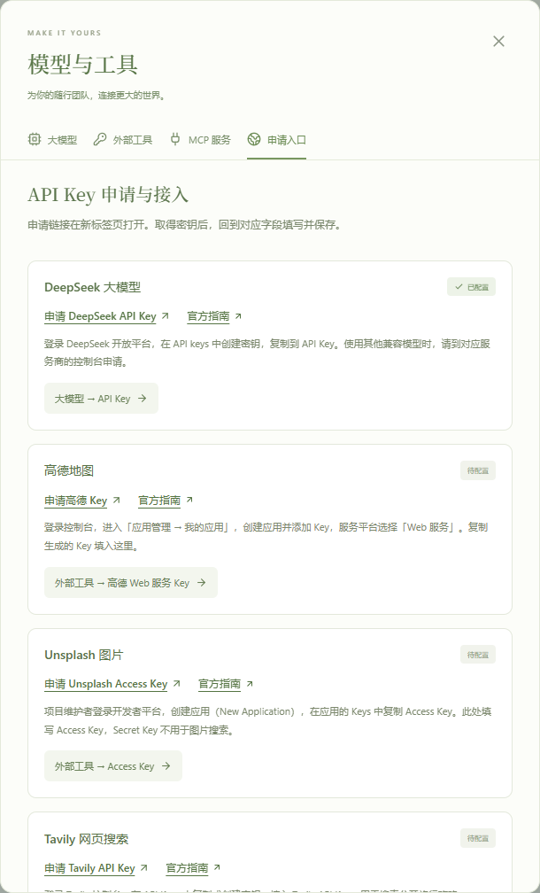
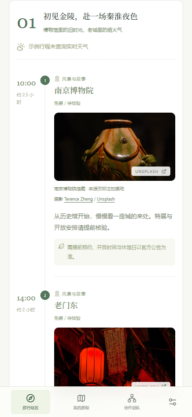
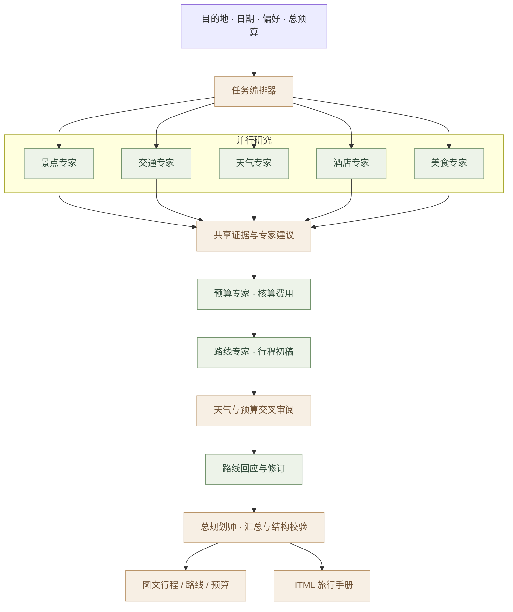

<div align="center">

# 山行 Roam

**把向往，写成旅程。**

由 7 位专家与 1 位总规划师协作的旅行规划 Web 应用。<br/>
从目的地、日期与预算出发，整理景点、美食、交通、住宿与天气，生成图文行程和可携带的 HTML 旅行手册。

<p>
  
  
  
  
</p>

[界面预览](#preview) · [快速开始](#quickstart) · [多智能体协作](#agents) · [服务配置](#configuration) · [开发与部署](#development)

</div>



<p align="center"><sub>目的地、预算、兴趣与节奏，在一个页面安排妥当。</sub></p>

> **可以先体验，再配置。** 启动后点击「体验南京示例」，无需外部 Key，即可查看每日行程、协作记录、预算、路线示意和 HTML 导出。示例是固定的上海出发、双人南京三日方案，不调用大模型。

## 一次规划，照顾完整旅程

| 能力                 | 使用体验                                                                     |
| -------------------- | ---------------------------------------------------------------------------- |
| **按你的偏好规划**   | 支持 1–14 天、同行人数、全程总预算、交通方式、兴趣、旅行节奏与补充需求。     |
| **多位专家共同完成** | 景点、交通、天气、住宿、美食并行研究，再做预算核算、路线整合和交叉审阅。     |
| **看见协作与依据**   | SSE 更新任务状态，保留专家建议、工具来源与待确认事项；长任务支持取消。       |
| **每一站都有画面**   | 景点与美食逐站关联 Unsplash 照片，展示摄影师、来源和取景说明。               |
| **路线与预算一起看** | 按天切换地点编号，拆分全体旅客的全程费用，提示超预算及未知金额。             |
| **把计划带走**       | 一键导出独立 HTML 手册，支持章节、日期切换与浏览器打印；历史行程保存在本机。 |

<a id="preview"></a>

## 界面预览

以下均为本地运行项目的真实截图，行程及协作内容来自内置南京示例。截图中的地图为**游览顺序示意图**；接入高德 Web 服务 Key 后可使用高德静态底图。点击图片可查看原图。

### 每日行程 · 让每一站有时间、有画面

图文时间轴串起景点和美食，旁边保留当日地点分布、费用余量与出行提醒。



### 从信息到决定 · 路线、预算与专家协作

<table>
  <tr>
    <td width="50%" valign="top">
      <a href="docs/screenshots/03-route-map.png"></a>
      <p><strong>逐日路线</strong><br/><sub>日期用颜色区分，停留点用编号对应。此图为未配置高德时的演示示意。</sub></p>
    </td>
    <td width="50%" valign="top">
      <a href="docs/screenshots/04-budget.png"></a>
      <p><strong>预算明细</strong><br/><sub>按全体旅客、整个行程核算，列出各项估算依据与参考余量。</sub></p>
    </td>
  </tr>
</table>



<p align="center"><sub>专家分工、交叉建议与结论在同一页面呈现。截图中的消息为演示记录。</sub></p>

### HTML 旅行手册 · 一份可以带走的计划

暖米色版式、目的地封面、每日地图与图文卡片，汇集行程规划、住宿交通、景点介绍、美食推荐和出行锦囊。



文字、预算和内嵌地图可离线查看；Unsplash 照片保留原站链接，需要联网加载。导出 HTML 本身无需安装 Chromium。

<details>
<summary><strong>更多界面：API Key 申请入口与手机端行程</strong></summary>

<p>设置内提供 DeepSeek、高德、Unsplash、Tavily 的申请链接、官方指南和填写位置。窄屏下，行程时间轴与图片自动适配。</p>

<table>
  <tr>
    <td width="60%" valign="top" align="center">
      <a href="docs/screenshots/07-settings.png"></a>
    </td>
    <td width="40%" valign="top" align="center">
      <a href="docs/screenshots/08-mobile.png"></a>
    </td>
  </tr>
</table>

</details>

<a id="quickstart"></a>

## 快速开始

需要 **Node.js 20.15+**，可使用与 Docker 镜像一致的 Node.js 22。

```bash
git clone https://github.com/XiaoyeCodes/roam-travel-agent.git
cd roam-travel-agent
npm ci
npm run dev
```

打开 [http://127.0.0.1:5173](http://127.0.0.1:5173/)。开发 API 位于 `http://127.0.0.1:8787`；按 `Ctrl+C` 停止服务。Windows 也可以运行项目内的 [启动山行.ps1](启动山行.ps1)。

1. **先看效果**：点击「体验南京示例」，浏览行程并下载 HTML 手册。
2. **连接模型**：进入「模型与工具 → 大模型」，填写 Base URL、模型名和 API Key。
3. **按需接入工具**：在「外部工具」配置地图、图片与搜索，在「MCP 服务」接入票务等查询能力。
4. **生成自己的旅行**：填写目的地、日期、预算和偏好，点击「生成我的旅行」。

也支持复制 [.env.example](.env.example) 为 `.env` 后配置。模型请求与密钥使用均在后端，设置接口仅返回配置状态。

<a id="agents"></a>

## 多智能体协作

每位专家拥有独立对话上下文和工具权限。信息专家先并行研究，预算与路线专家整合结果；天气、预算专家再审阅路线，由路线专家回应并修订，最后交给总规划师生成结构化方案。



| 专家        | 主要职责                                                      |
| ----------- | ------------------------------------------------------------- |
| 景点 / 美食 | 根据偏好搜索 POI 与公开攻略，整理景点、菜品、餐馆及预约提醒。 |
| 交通 / 酒店 | 查询往返票务、自驾方案与住宿片区，标记尚未确认的班次或房价。  |
| 天气        | 查询覆盖出行日期的预报，提出雨天备选和路线调整建议。          |
| 预算        | 核算往返、市内交通、住宿、餐饮、门票与弹性预留。              |
| 路线        | 结合距离、时长、天气和预算安排每日行程，并回应审阅意见。      |
| 总规划师    | 汇总专家结论，输出经过日期、金额和结构校验的最终方案。        |

更多实现细节见 [架构与目录](docs/ARCHITECTURE.md)。

<a id="configuration"></a>

## 服务配置

在 **「模型与工具 → 申请入口」** 可以直接打开申请页面并查看填写说明。

| 服务                       | 用途                                | 配置 / 申请入口                                                                                        |
| -------------------------- | ----------------------------------- | ------------------------------------------------------------------------------------------------------ |
| DeepSeek / OpenAI 兼容模型 | 专家分析、讨论与最终规划            | `LLM_BASE_URL`、`LLM_MODEL`、`LLM_API_KEY` · [DeepSeek 控制台](https://platform.deepseek.com/api_keys) |
| 高德地图                   | POI、酒店、餐馆、自驾路线、静态底图 | `AMAP_KEY`，选择 **Web 服务** · [高德控制台](https://console.amap.com/dev/key/app)                     |
| Unsplash                   | 景点、美食相关照片                  | `UNSPLASH_ACCESS_KEY`，填写 **Access Key** · [创建应用](https://unsplash.com/oauth/applications)       |
| Tavily                     | 公开攻略与网页搜索                  | `TAVILY_API_KEY` · [Tavily 控制台](https://app.tavily.com/)                                            |
| Open-Meteo                 | 目的地天气预报                      | 当前接入端点无需 Key · [服务说明](https://open-meteo.com/en/docs)                                      |
| 铁路 / 机票 MCP            | 列车与航班查询                      | 在设置中填写 HTTP / SSE 服务地址 · [12306 社区实现](https://github.com/Joooook/12306-mcp)              |

铁路与机票需分别接入；12306 MCP 只负责铁路。MCP 支持 Bearer Token、按专家分配工具及连接测试。完整配置、密钥导入、工具权限和数据口径见 [配置指南](docs/CONFIGURATION.md)。

### 数据如何呈现

- **费用**以人民币、全体旅客、整个行程计算。未知费用单独标记，参考估算不等于实际报价。
- **地图**只使用核验坐标；连线表示游览顺序。没有高德 Key 时，示例使用明确标注的顺序示意图。
- **天气与票务**保留查询状态；日期超出预报范围、服务未接入或查询失败时显示待确认。
- **图片**来自 Unsplash 搜索或有来源的精选图库；相关配图不等于推荐地点或餐馆的实拍。
- **使用范围**为单用户、单进程应用，负责查询与规划；不下单、不支付。多人部署需增加账户隔离、数据库与任务队列。

<a id="development"></a>

## 开发与部署

React 19 + Vite + TypeScript 构建前端；Express + TypeScript 提供 API；MCP SDK 连接外部查询工具，SSE 推送协作事件，Zod 校验输入与模型输出。

```text
client/src/        规划界面、行程、设置、地图与响应式布局
server/src/        智能体编排、模型驱动、MCP、图片和 HTML 导出
shared/            前后端共享类型
server/tests/      规则、MCP 协议、协作流程与导出测试
scripts/           配置导入、UI 检查、生产检查与 README 截图
docs/              配置、架构、部署文档与真实界面截图
```

```bash
npm run check      # TypeScript 检查
npm test           # 本地隔离模型 / MCP 集成测试
npm run build      # 构建前后端
npm start          # 生产服务：http://127.0.0.1:8787
```

支持独立前端部署，也提供 [Dockerfile](Dockerfile) 和 [compose.yaml](compose.yaml)。容器部署前需配置 `APP_ACCESS_TOKEN`；详细步骤、跨域设置与 UI 检查见 [开发与部署指南](docs/DEVELOPMENT.md)。

| 文档                                       | 内容                                             |
| ------------------------------------------ | ------------------------------------------------ |
| [配置与数据说明](docs/CONFIGURATION.md)    | 环境变量、API Key 申请、MCP 接入、图片与地图规则 |
| [架构与多智能体协作](docs/ARCHITECTURE.md) | 编排流程、共享证据、目录结构、当前运行边界       |
| [开发、验证与部署](docs/DEVELOPMENT.md)    | 本地测试、生产构建、Docker、访问口令、截图复现   |
| [截图说明](docs/screenshots/README.md)     | 截图来源、页面对应关系与更新方法                 |

<details>
<summary><strong>实现参考与图片来源</strong></summary>

- [DeepSeek API](https://api-docs.deepseek.com/api/create-chat-completion/)
- [高德 MCP](https://lbs.amap.com/api/mcp-server/create-project-and-key) · [高德静态地图](https://developer.amap.com/api/webservice/guide/api/staticmaps/)
- [MCP TypeScript SDK](https://github.com/modelcontextprotocol/typescript-sdk)
- [Open-Meteo](https://open-meteo.com/en/docs) · [Tavily](https://docs.tavily.com/documentation/api-reference/endpoint/search) · [Unsplash](https://unsplash.com/documentation)

首页旅行照片来自 Unsplash；南京示例照片的原始页面与摄影师记录保存在 [photo-catalog.ts](server/src/photo-catalog.ts)，界面和 HTML 手册均保留署名。截图直接截取应用页面，不使用生成式界面示意图。

</details>

---

<p align="center"><sub>山行 ROAM · 用一点智能，换多一点自由。</sub></p>
