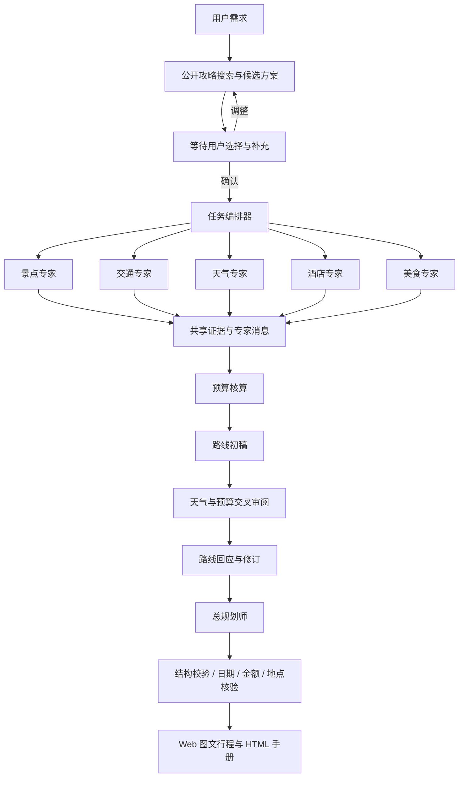

# 架构与多智能体协作

[← 返回 README](../README.md)

```text
client/                 React + Vite + TypeScript
  src/App.tsx           规划表单、行程、预算、协作与历史
  src/ProposalReview.tsx 候选方案比较、补充意见与确认
  src/WorkProgress.tsx   当前工作、真实查询条件、阶段结果与待确认事项
  src/Settings.tsx      模型和工具设置
  src/ApiGuide.tsx      API Key 申请入口与接入说明
  src/StopPhoto.tsx     逐站图片、来源署名与加载状态
  src/MapView.tsx       地图与每天的景点编号
server/src/
  index.ts              HTTP API、SSE、来源校验、访问口令
  workflow.ts           多智能体编排、交流、审阅与汇总
  proposals.ts          公开攻略检索、候选方案生成与确认状态转换
  work-progress.ts      查询动作与结果摘要，公开字段白名单和敏感值过滤
  revisions.ts          日内修改草稿、锁定约束、应用与撤销、版本冲突保护
  quality.ts            字段事实、开放时间、站间路线及日程冲突检查
  quality-html.ts       导出手册中的事实来源、日程检查与版本摘要
  llm.ts                OpenAI 兼容模型驱动
  mcp.ts                MCP 动态发现与查询权限
  tools.ts              地图、天气、搜索、票务状态、预算、图片
  maps.ts               高德静态地图与明确标注的示意图
  html.ts               可独立打开的 HTML 旅行手册
  photos.ts             逐站图片搜索、缓存、导出使用记录
  photo-catalog.ts      南京精选照片与来源
  pdf.ts                旧 PDF 接口兼容
  schema.ts             输入和输出校验、日期、金额计算
  store.ts              本地持久化、任务事件与取消
shared/types.ts         前后端共享数据类型
shared/work-progress.ts 持久化事件与 SSE 的一致重放、查询配对和中断状态
server/tests/           规则、MCP 协议与全流程测试
scripts/ui-smoke.mjs    桌面/手机 UI 与真实 HTML 手册下载检查
scripts/capture-readme.mjs  从真实本地应用截取 README 配图
docs/screenshots/      随仓库发布的项目截图
.data/                  本机配置与旅行记录，不提交 Git
output/                 检查截图与演示手册，不提交 Git
```



模型调用在后端执行。初始专家各有独立上下文；下游专家收到上游报告和证据，交叉审阅产生明确的收件人消息，路线专家再回应。界面呈现业务结论和工具状态，不展示模型内部推理。

工作进度通过 `TripEvent.work` 传输可公开的业务动作。每次查询使用独立 ID 配对开始与返回事件，展示真实搜索条件、来源和结果摘要；并发、重试与刷新重放不会将不同查询混在一起。结果分为成功、部分待确认、无结果、未配置、失败和演示，外部 MCP 的未解析内容不会被当成已解决的问题。专家报告单独呈现阶段结论、发现和待确认项，原始协作记录默认折叠。取消或中断后，尚未完成的工作停止显示运行状态。旧记录兼容已有消息与报告，不补造未保存的搜索条件。

智能规划先进入候选阶段，调用 `search_web` 分别检索小红书公开页面和其他公开网页，再生成 2–3 个结构化方向。`awaiting_confirmation` 状态会持久化方案、来源和已提交的反馈，关闭本轮 SSE 并释放工作流资源。只有 `POST /api/trips/:id/decision` 的 `confirm` 操作可以启动详细规划；`revise` 会生成新版候选并再次等待确认。请求携带 `proposalId`，过期版本和重复提交返回 409，缺少选择或修改意见返回 400。点击卡片本身不发送确认请求。

确认的方案与历轮补充意见进入所有专家及总规划师的上下文，并存入最终计划的 `confirmedSelection`。后续明确修改优先；不可行的要求应说明原因及替代建议。来源链接只保留实际成功搜索返回的 HTTP(S) URL。未配置搜索或没有搜索结果时明确提示，不声称获得热度排名。

当前是单用户、单进程本地应用；并行任务最多 3 个，等待确认不占用任务额度，专家工具调用最多 4 轮，每轮执行最多 4 个工具。运行和等待期间均可取消。刷新页面或重启服务后可继续确认；方案修改失败或被重启中断时保留上一版和用户意见，其他被重启中断的运行任务标为错误。固定南京演示保留直接预览。任务与设置以本地 JSON 保存；多人部署需要增加账户隔离、数据库和持久任务队列。
