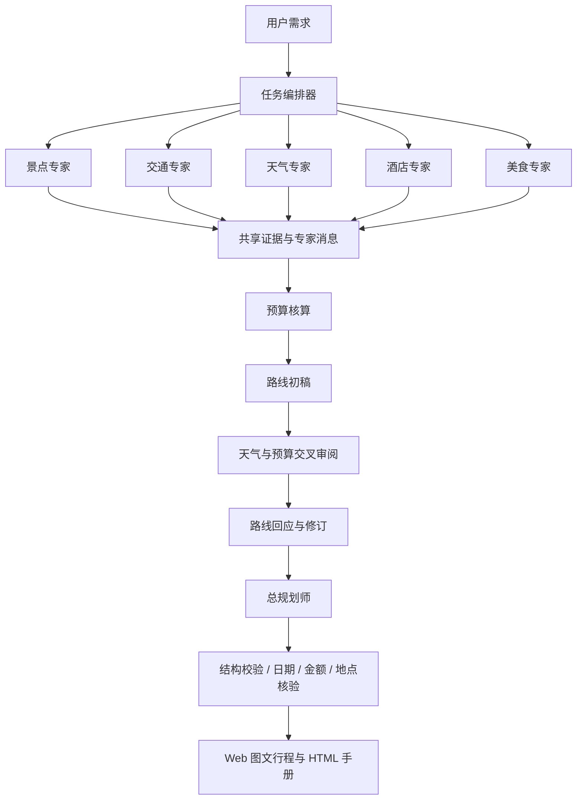

# 架构与多智能体协作

[← 返回 README](../README.md)

```text
client/                 React + Vite + TypeScript
  src/App.tsx           规划表单、行程、预算、协作与历史
  src/Settings.tsx      模型和工具设置
  src/ApiGuide.tsx      API Key 申请入口与接入说明
  src/StopPhoto.tsx     逐站图片、来源署名与加载状态
  src/MapView.tsx       地图与每天的景点编号
server/src/
  index.ts              HTTP API、SSE、来源校验、访问口令
  workflow.ts           多智能体编排、交流、审阅与汇总
  llm.ts                OpenAI 兼容模型驱动
  mcp.ts                MCP 动态发现与查询权限
  tools.ts              地图、天气、搜索、票务状态、预算、图片
  maps.ts               高德静态地图与明确标注的示意图
  html.ts               可独立打开的 HTML 旅行手册
  photos.ts             逐站图片搜索、缓存、导出使用记录
  photo-catalog.ts      南京精选照片与来源
  pdf.ts                旧 PDF 接口兼容
  schema.ts             输入和输出校验、日期、金额计算
  store.ts              本地持久化、任务事件与取消
shared/types.ts         前后端共享数据类型
server/tests/           规则、MCP 协议与全流程测试
scripts/ui-smoke.mjs    桌面/手机 UI 与真实 HTML 手册下载检查
scripts/capture-readme.mjs  从真实本地应用截取 README 配图
docs/screenshots/      随仓库发布的项目截图
.data/                  本机配置与旅行记录，不提交 Git
output/                 检查截图与演示手册，不提交 Git
```



模型调用在后端执行。初始专家各有独立上下文；下游专家收到上游报告和证据，交叉审阅产生明确的收件人消息，路线专家再回应。界面呈现业务结论和工具状态，不展示模型内部推理。

当前是单用户、单进程本地应用；并行任务最多 3 个，专家工具调用最多 4 轮，每轮执行最多 4 个工具。长请求可取消。服务重启会将未完成任务标为中断，可重新规划。任务与设置以本地 JSON 保存；多人部署需要增加账户隔离、数据库和持久任务队列。
